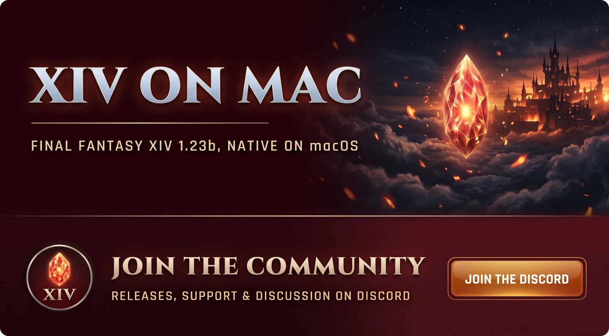

# FINAL FANTASY XIV 1.23b for Mac


> [!IMPORTANT]
> ## ▶ To play, run the [installer](docs/install.md)
>
> Mount your FINAL FANTASY XIV disc, then paste into Terminal:
>
> ```bash
> curl -fsSL https://raw.githubusercontent.com/rubymatrix/ffxiv-classic-recomp/main/install.command | bash -s -- --server <host>
> ```
>
> Needs a Mac with Apple silicon (M1 or later), your own FINAL FANTASY XIV disc, and a server to
> play on. The [install guide](docs/install.md) walks through it.

The original FINAL FANTASY XIV (1.0, patch 1.23b), running natively on Apple silicon Macs. No
Wine, no Rosetta. The game is rebuilt for your Mac from your own disc, and the app patches it up to
1.23b for you.

It plays on 1.23b private servers such as
[Project Meteor](https://github.com/Ioncannon/project-meteor-server).

## Videos

<table>
  <tr>
    <td width="33%">
      <a href="https://www.youtube.com/watch?v=4Xooe423mC0&t=204s"></a>
      <br>Final Fantasy XIV 1.23b, Project Meteor
    </td>
    <td width="33%">
      <a href="https://www.youtube.com/watch?v=Mgkrrv3KpSM&t=96s"></a>
      <br>It Kills with Fire: Ifrit story mode
    </td>
    <td width="33%">
      <a href="https://www.youtube.com/watch?v=BzEjkifaPec&t=2s"></a>
      <br>Bowl of Embers (Hard)
    </td>
  </tr>
</table>

## Documentation

| | |
| --- | --- |
| [Installing](docs/install.md) | Install, patch and play, step by step |
| [Building by hand](docs/building.md) | For developers |

## Help

Stuck? Ask on the [XI on Anything Discord](https://discord.gg/4vUKPgyvEp).

<a href="https://discord.gg/4vUKPgyvEp"></a>

## No game files here

This repo holds no Square Enix code or data, and never will. The game is rebuilt on your own Mac
from your own disc, and none of that is committed.

## Credits

The recompiler comes from [xi-on-anything](https://github.com/rubymatrix/xi-on-anything), which
does the same for FINAL FANTASY XI.

## License

MIT (see `LICENSE`). FINAL FANTASY is a registered trademark of Square Enix Holdings Co., Ltd.
This project is not affiliated with or endorsed by Square Enix.
